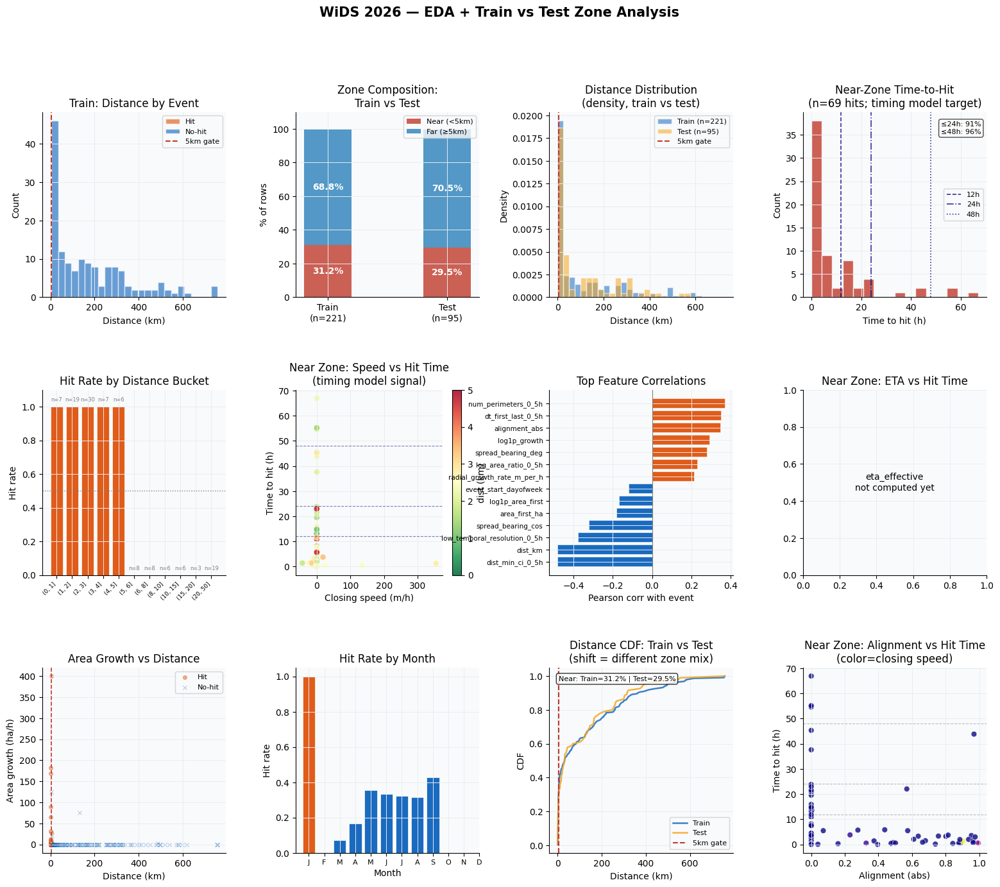

# WiDS Global Datathon 2026 — Wildfire Evacuation: Tri-Survival Stack

**WiDS Global Datathon 2026 — final rank 275 / 1,754 (top 15.7%), best LB 0.97167.**

Survival analysis on a **221-row training set**: predict the probability that a
wildfire reaches an evacuation zone within 12 / 24 / 48 / 72 hours, under a hybrid
metric `0.3 × C-index + 0.7 × (1 − WBrier)` — with heavy right-censoring, 56 engineered
features, and a stacked ensemble of three structurally different survival models.

## The problem, in one paragraph

Each row is one observed wildfire with weather, terrain, fire-behavior and
distance-to-evacuation-zone features. The target is not a class label but a
**survival curve evaluated at four horizons**: P(hit by 12h), P(hit by 24h), …
Many fires are observed past 72h without ever hitting the zone (right-censored),
so naive classification targets are biased — the pipeline uses proper survival
models plus IPCW-reweighted binary calibrators.

## The central insight: the 5 km distance gate

EDA showed the dataset splits into two almost-separate problems:

```
Near zone (dist < 5 km):  every fire in training hits the zone  →  predict WHEN (timing discrimination)
Far zone  (dist ≥ 5 km):  virtually no fire ever hits          →  predict IF   (rare-event detection)
```

Every component of the stack is therefore **distance-stratified**: models are
blended with different weights per zone, calibrators are trained separately per
zone, and the final blend treats near and far rows with different instruments.
Near-zone timing is dominated by GBSA; far-zone subtle alignment/speed signals get
more CoxPH weight.

## The tri-survival stack

| Component | What it is | Bagging (small-data defense) |
|---|---|---|
| **GBSA** | Gradient Boosting Survival Analysis (componentwise gradient boosted smooth spline predictors) — main timing signal | 10 configs × **40 seeds** × 5-fold CV-bag |
| **CoxPH** | ℓ2-penalized Cox Proportional Hazards — linear log-hazard view | 7 alphas × **20 seeds** × 5-fold CV-bag |
| **RSF** | Random Survival Forest — bagged-tree, log-rank splits | 3 configs × **15 seeds** × 5-fold CV-bag |
| **LGB IPCW calibrators** | LightGBM binary classifiers per (zone, horizon), trained on censored-safe targets with **IPCW weights** | zone-split: near & far separate |
| **Near-zone timing model** | Log-normal regression of time-to-hit — **diagnostics only (weight 0.0)**: σ = 1.97 too diffuse to beat the survival curves | — |

With 221 rows, any single fit is noise; averaging hundreds of seed-fold fits is the
workhorse that makes the 69-event near-zone signal usable.



## Metric handling details worth stealing

- **IPCW binary targets**: at horizon h, rows censored before h are *excluded*
  (unknown outcome), and remaining rows get inverse-probability-of-censoring
  weights — the standard fix that makes binary Brier calibration consistent
  under censoring.
- **72 h = constant 1.0.** So many rows are censored before 72h that the Brier
  term is dominated by the near-certain near-zone hits; setting P(72h) = 1 for
  every row beat every model output across all runs (verified against LB).
- **Monotonicity enforcement**: P(12h) ≤ P(24h) ≤ P(48h) ≤ P(72h) is clipped into
  validity after blending.
- **Censoring-aware validation**: the OOF C-index only uses comparable pairs
  (event rows vs. longer-surviving rows).

## Experiment log — and the honest lesson

| Run | near-zone Cox weight | OOF | LB | Verdict |
|---|---:|---:|---:|---|
| 001 baseline | 0.10 | 0.97193 | 0.97070 | |
| 002 v3 (+ zone-split LGB + timing) | 0.10 | 0.97312 | 0.97152 | |
| **003 v4 (best)** | **0.14** | 0.97265 | **0.97167** | best LB |
| 004 v5 | 0.08 | 0.97299 | 0.97114 | OOF↑ LB↓ |
| 005 v6 | 0.14 | — | — | **reverted to v4 weights, locked** |

**OOF and LB were anti-correlated for the near-zone Cox weight.** Root cause:
69 near rows ÷ 5 folds ≈ 14 rows per fold — a per-fold weight sweep is pure noise,
so a *better* OOF number was just overfitting the fold split. v6 therefore
**locked the v4 near-zone weights permanently** and removed the near-zone sweep
(the far-zone search stays, since 152 far rows give it statistical footing).
This notebook is that v6.

## Results

| | |
|---|---|
| Final rank | **275 / 1,754 (top 15.7%)** |
| Best LB | **0.97167** (v4 weights, retained in v6) |
| Metric | 0.3 × C-index + 0.7 × (1 − WBrier), WBrier = 0.3·B24 + 0.4·B48 + 0.3·B72 |
| OOF far-zone Brier | B@24 = 0.001 (solved); near-zone B@24 ≈ 0.074 is the ceiling |
| Training data | 221 rows × 56 engineered features · 69 events · 69 near / 152 far |

## Repository structure

```
├── notebooks/wids-2026-tri-survival-stack-v6.ipynb   # complete pipeline with EDA, all sections and outputs
├── figures/eda_dashboard_13axes.png                  # 13-panel EDA dashboard (zone split, timing, censoring)
├── README.md · requirements.txt · LICENSE (Apache-2.0)
```

The notebook is the single self-contained pipeline; it expects the competition
data at `/kaggle/input/competitions/WiDSWorldWide_GlobalDathon26` (Kaggle-attached)
and installs `scikit-survival` at runtime.

## License

[Apache-2.0](LICENSE)
